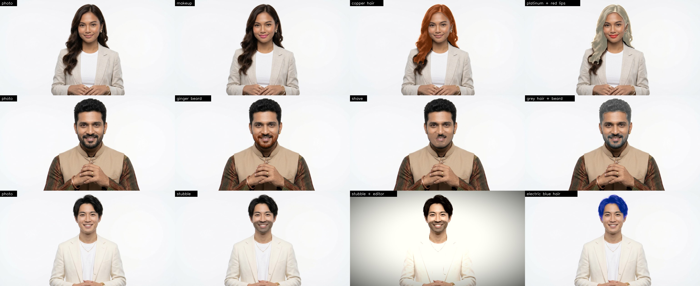
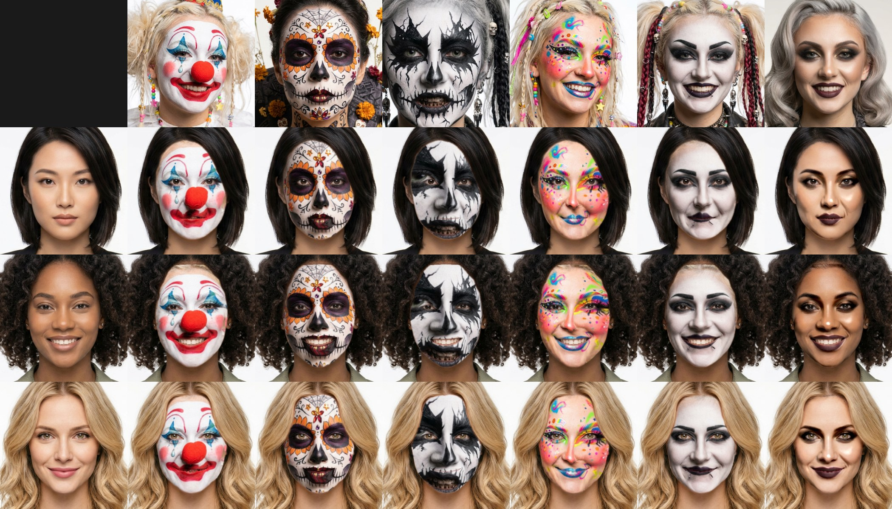
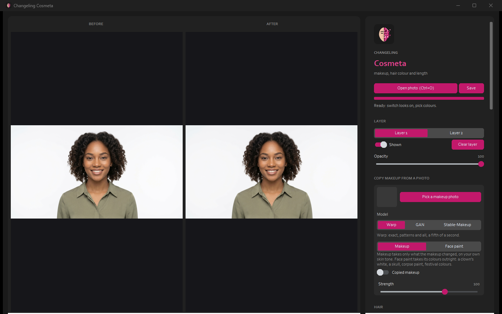

  

# Changeling Cosmetics

**Website:** https://cursedprograms.github.io/Changeling-Cosmetics/

*Part of the Changeling family, all together in [Changeling Studio](https://github.com/CursedPrograms/Changeling-Studio):
[CopyCat](https://github.com/CursedPrograms/Changeling-CopyCat) ·
[CopyCat Realtime](https://github.com/CursedPrograms/Changeling-CopyCat-Realtime) ·
[Tiresias](https://github.com/CursedPrograms/Changeling-Tiresias) (gender) ·
[Chronos](https://github.com/CursedPrograms/Changeling-Chronos) (age) ·
[Natio](https://github.com/CursedPrograms/Changeling-Natio) (where in the world) ·
**Cosmetics** (makeup, hair, beards) ·
[Echo](https://github.com/CursedPrograms/Changeling-Echo) (voices) ·
[Tonsor](https://github.com/CursedPrograms/Changeling-Tonsor) (hairstyles) ·
realtime: [Tiresias](https://github.com/CursedPrograms/Changeling-Tiresias-Realtime) ·
[Chronos](https://github.com/CursedPrograms/Changeling-Chronos-Realtime) ·
[Natio](https://github.com/CursedPrograms/Changeling-Natio-Realtime) ·
[Cosmetics](https://github.com/CursedPrograms/Changeling-Cosmetics-Realtime).*

FaceApp-style cosmetics for photos: makeup, hair colour, beards and stubble, painted onto the face itself so
the light and texture underneath stay (a lipstick keeps the lips' lines, a hair colour keeps every strand).
Two layers that stack, a basic editor, and photographic makeup looks, hair length or a full beard through
[AetherCanvas AI](https://github.com/CursedPrograms/AetherCanvas-AI). Every face above is an AI-generated person who
doesn't exist.

### Copy makeup from a photo

The top row is the makeup; each row below is a person wearing it. The reference's face is warped onto hers
triangle by triangle, so the drawn patterns land where they were: the clown's stars and tears, the skull's petals
and web, the corpse paint's cracks, the festival dots. **Face paint** (the first five) takes the colours outright;
**Makeup** (dark glam, last) takes only what the makeup changed and keeps her own skin tone. All the faces are
AI-generated people who don't exist.

## Use it

Start `run.bat` (or `.\run.ps1`, `./run.sh`). The first time it sets itself up: Python 3.11 with MediaPipe,
OpenCV, ONNX Runtime and customtkinter, and the face parser (`models/face_parsing_int8.onnx`, about 90 MB). No GPU
needed. `run.bat photo.jpg` opens with that photo.

| Control | Does |
| --- | --- |
| **Open photo** (<kbd>Ctrl</kbd>+<kbd>O</kbd>), **Save** (<kbd>Ctrl</kbd>+<kbd>S</kbd>) | the face is read once (a few seconds); Save writes the full-size result |
| **Copy makeup from a photo** | pick a photo of a face wearing makeup (`makeup_refs/`). **Makeup**: its lips, eyes, blush and brows come over, your own skin tone stays. **Face paint**: everything comes over, a clown's or a goth's white base too. It copies colours and style, not drawn patterns (cracks, stars, motifs) |
| **Layer 1 / Layer 2** | two layers that stack, each with its own looks, editor, **Opacity** and **Shown**; **Clear layer** starts one again |
| **Hair colour** | 11 colours (platinum to electric blue) or any colour (+) |
| **Lips** | lipstick, with **Gloss** |
| **Eyeshadow, Eyeliner, Blush, Brows** | each with its own colours and strength |
| **Smooth skin** | an edge-keeping blur on the skin only |
| **Beard colour, Stubble, Shave** | colour a beard or moustache, paint stubble in, shave stubble or a short beard off |
| **Editor** | brightness, contrast, saturation, warmth, vignette, sharpen |
| **AI looks** (AetherCanvas AI) | makeup: natural, glam, smoky eyes, winged liner, red, nude or berry lips, glow, soft glam, gothic, bridal, freckles, no makeup; hair length: bangs, curly, straight, ponytail, bun, braids; full beard, goatee, moustache, clean shaven: sent to AetherCanvas AI when it's running (a minute or two each); **Back to the original photo** undoes them |

Every control answers at once: the preview is worked on a smaller copy, and Save paints the full-size photo.

## How it works

1. **Read the face, once.** A SegFormer face parser ([jonathandinu/face-parsing](https://huggingface.co/jonathandinu/face-parsing),
   int8 ONNX) labels every pixel: hair, skin, nose, lips, brows, eyes, ears, neck, clothes. MediaPipe Face Mesh
   finds the face's 468 points (for the eyelids, cheekbones and the beard area).
2. **Paint in LAB.** Each look is a colour blended into its region: the region's brightness moves part of the way
   to the colour's, its tint all the way, its own fine variation stays. Gloss brightens where the lips already
   catch the light.
3. **Facial hair.** The beard area is the jaw from cheek to cheek up to the nostrils, without the lips; the beard is
   whatever in it is clearly darker than the face's own skin. Shave puts the face's own skin tone (a normalised
   blur of the skin around it) back over it; stubble is an even shade with a fine grain.
4. **Copied makeup.** Both faces are read with Face Mesh (478 points, plus a ring around each face reaching up the
   forehead). The reference is cut into those triangles and each one is warped onto yours, at full size, so every
   stroke lands where it was: a clown's star over your eye, a skull's teeth on your lips, whatever your face's shape.
   **Face paint** takes the reference's colours outright and keeps your skin's fine texture under them. **Makeup**
   takes only what the makeup changed, compared with the reference's own bare skin around it, and adds that to your
   skin. The lips take the reference's lip colour. Your eyes and open mouth stay your own (the reference's are filled
   in before warping). About a fifth of a second a photo; no model to download. Painted faces Face Mesh can't read
   straight away are cropped to the face OpenCV's YuNet finds and read again.

   Its limits: a reference with an open mouth on a closed one (or the other way) leaves the paint around the lips
   less tidy. A reference turned well away from the camera stretches. Hats, noses and the like aren't 3D: a clown's
   red nose is painted on.
5. **Two layers.** Layer 2 is painted onto Layer 1's result with the same masks, each with its editor and opacity.

`cosmetics/adjust.py` (the editor) is the same file in every Changeling.

## Licenses

The code is MIT; The face parser was trained on CelebAMask-HQ, which is for non-commercial research; MediaPipe is
Apache 2.0.

---

 

© Cursed Entertainment 2026

 

 

  

